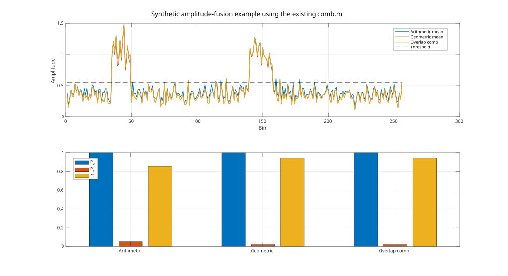

# Overlapping-Subband Spectrum Fusion

Amplitude fusion and overlapping-subband decisions for cooperative sparse-spectrum recovery.

[](https://github.com/LhadjBENZATER/Overlap-and-Correlation-based-fusion-rule/actions/workflows/validate.yml)
[Paper](https://doi.org/10.1088/1402-4896/ae19aa) · [Download releases](https://github.com/LhadjBENZATER/Overlap-and-Correlation-based-fusion-rule/releases) · [Researcher website](https://lhadjbenzater.github.io/)

The quick start generates four nonnegative noisy spectra and calls the existing `comb.m` to extend geometric-mean detections across arithmetic-mean subbands. It compares arithmetic, geometric and combined decisions at one fixed threshold.

## Run the example

Download and extract the latest release, or clone:

```bash
git clone https://github.com/LhadjBENZATER/Overlap-and-Correlation-based-fusion-rule.git
cd Overlap-and-Correlation-based-fusion-rule
```

Open MATLAB in this directory and run:

```matlab
result = demo_fusion;
```

The example generates its inputs and needs no private files or SDR hardware.
It writes `results/demo_metrics.csv`, `results/demo_results.mat` and
`docs/preview.svg`. The SVG can be opened in a browser. For numerical output
without plotting, run `result = demo_fusion(false);`.

The new example uses base MATLAB only. MATLAB R2017b or later is recommended.
CI runs the numerical checks and plotting example in **MATLAB R2024a on Linux**.
The measured elapsed time and actual runtime version appear in
[the validation log](docs/validation.txt). Runtime depends on hardware and
MATLAB release. GNU Octave compatibility has not been established.



## Model, assumptions and interpretation

Four synthetic spectra contain two active subbands in 256 bins and
complex Gaussian perturbations with per-quadrature scale 0.3 before magnitude.
The random seed is `20261121`. Arithmetic and geometric means are computed
from these nonnegative amplitudes, and the existing overlap combiner uses
threshold 0.55. This is a single generated realization, not a Monte Carlo
performance estimate or a threshold-calibrated comparison.

This demo demonstrates the overlap helper only. It does not implement the full
normalized-correlation weighted-fusion procedure from the paper.

Bin scoring uses TP, FP and FN with **no guard bins or frequency tolerance**:
`Pd = TP/K`, `Pf = FP/(N-K)`, and `F1 = 2TP/(2TP+FP+FN)`.
The detector's support-cardinality policy is described above.

The new example is a reproducible onboarding experiment, **not a reproduction
of the paper's full numerical campaign or hardware measurements**. The legacy
scripts remain available with their original names.

## Files and historical experiments

| Files | Purpose / prerequisites |
|---|---|
| `comb.m` | Existing overlap helper, exercised directly by the new demo and boundary checks. |
| `Pd_Pfa_2D_SDR.m` | Historical hardware-data analysis; needs recorded inputs and acquisition/recovery helpers not included here. |
| `Pd_Pfa_3D_Avgs.m` | Historical sensing simulation; requires external waveform, channel and recovery helpers. |
| `Review_Spectra.m`, `curves.m` | Historical analysis/plot scripts; inspect data loads and external helper calls before use. |

The new amplitude-fusion example uses generated inputs. It must not be reported
as a reconstruction of the original SDR measurements or weighted-fusion study.

See [the dependency inventory](docs/LEGACY_DEPENDENCIES.md) before running older
scripts. The new example deliberately avoids those external dependencies.

## Validation

```matlab
addpath tests
run_tests
run_validation
```

`run_validation` runs numerical checks, the demo, and the figure export. GitHub
Actions preserves CSV/MAT outputs as an `example-results` artifact and records
the preview and validation log after a successful main-branch run. The CI badge
reports execution status; it is not a certification of the paper's conclusions.

## Citation

Associated publication: **Blind weighted fusion and overlapping subband methods for cooperative sparse recovery in compressed sensing**, Physica Scripta, 100(11), 115210, 2025.
DOI: [10.1088/1402-4896/ae19aa](https://doi.org/10.1088/1402-4896/ae19aa).

Use GitHub's **Cite this repository** control for citation metadata. Cite the
paper when discussing its method, and identify the software release/commit
when reporting results from this code. Paper authorship and software-maintainer
metadata are distinguished in [CITATION.cff](CITATION.cff).

## Questions and contributions

Open an issue with your MATLAB version, command, parameters and full error.
See [CONTRIBUTING.md](CONTRIBUTING.md). Research enquiries:
[Hadj Abdelkader Benzater — EMP](https://lhadjbenzater.github.io/).

## License

Author-contributed code is available under [MIT](LICENSE).
Retain copyright and attribution notices when reusing the code.
